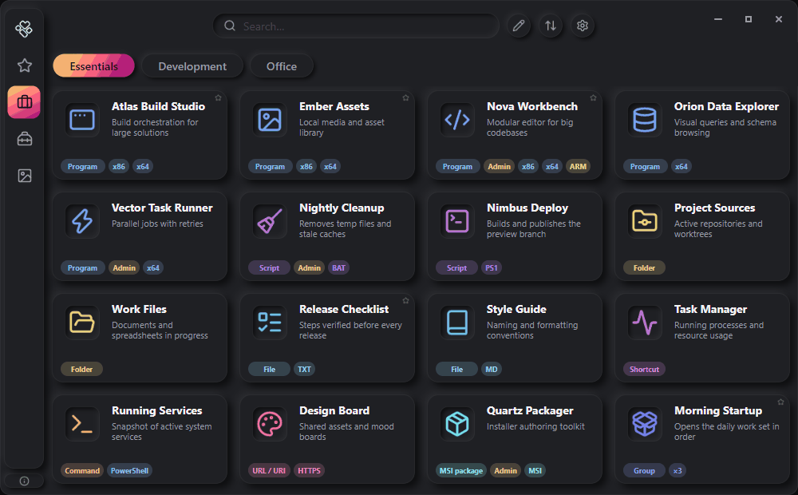

[**English**](README.md) · [Русский](README_RU.md)

# Errant Launcher

**Everything you need. In one place.**

Apps, files, scripts, commands, and links — organized into quick-launch cards. Arrange everything your way and keep the tools you need close at hand. Extract to a folder or a USB drive and your entire workspace travels with you.

**[→ More screenshots](https://errantlauncher.com/screenshots/)**

## About

Errant Launcher is for those who want to organize their own digital workspace. Instead of scattered shortcuts and files you open by hand every time, it offers a single interface where you decide how your workspace is arranged and which tools stay within reach.

## What makes it different

- **Truly portable** — writes only to its own `ErrantLauncher` folder. No registry, no user profile, no temp files. Copy it to a flash drive and go.
- **Zero telemetry** — no analytics, no update checks: the app never connects to the internet on its own.
- **Open data** — the whole configuration lives in readable JSON files: inspect, hand-edit, or back up with git — no vendor lock-in.
- **More than shortcuts** — a card grid, not a pile of desktop shortcuts: commands, scripts, and grouped tasks in one interface.

## Errant Launcher Features

### Cards and launching

- **9 card types** — applications, scripts, folders, files, shortcuts, commands, URLs / URIs, MSI packages, and groups.
- **Availability status** — see when a file is missing, a drive is unavailable, or a source cannot be accessed.
- **Sequential group launch** — combine cards into groups, customize their launch order and delays, then run the entire sequence with a single click.
- **Run as administrator** — launch individual cards with elevated privileges, or run the launcher as administrator to launch all cards that support elevated execution with elevated privileges.
- **System tray** — minimize the application to the notification area and restore it using the Open / Exit menu.

### Organization and personalization

- **Organization** — sections and categories, favorites, search by card name, file name, or description, and sorting by custom order, name, type, or launch frequency.
- **Duplicate and hide** — duplicate cards and hide sections or categories without deleting them.
- **Custom icons** — choose from the built-in icon collection, assign your own images to cards of any type, or use icons automatically extracted from EXE files and shortcuts.
- **Customize the look** — 15 themes, a separate accent color, and color styles for card icons and badges.
- **6 interface languages** — Russian, English, Ukrainian, Azerbaijani, Spanish, and Brazilian Portuguese.

### Adding cards

- **Editor** — create cards manually: pick a type and fill in the fields — from an app to a command or a group.
- **Bulk import** — scan folders and turn discovered applications, files, scripts, and shortcuts into cards.
- **Drag & drop** — drag files, shortcuts, and links into the window to create cards.

### Portability and data

- **Portable setup** — paths within the data folder remain relative, so you can move the launcher to a USB drive or another folder; external files must remain accessible at their saved locations.
- **Backup and sharing** — create a full backup of the application or share your card collection with other users.
- **Read-only mode** — use the launcher from protected folders without write permissions.

## Quick start

**Requires Windows 10 (version 1607) or newer, x64** — ARM devices run the x64 build through Windows emulation.

1. **Download the ZIP** from [Releases](https://github.com/errantlauncher/ErrantLauncher/releases) and extract it anywhere.
2. **Keep the files together** — `ErrantLauncher-x64.exe`, `libSkiaSharp.dll`, and `av_libglesv2.dll` must stay in the same folder.
3. **Run `ErrantLauncher-x64.exe`** — an `ErrantLauncher` data folder is created next to the executable. Open **Editor** to add sections, categories, and cards, or drag files in.

For detailed instructions, see the [User Guide](https://errantlauncher.com/docs/guide/).

## Verification

The executable is not digitally signed. Compare the SHA-256 hash of the downloaded ZIP with the `.zip.sha256` file published alongside it in [Releases](https://github.com/errantlauncher/ErrantLauncher/releases) — the same hash is shown on the [download page](https://errantlauncher.com/download/). The hashes of the EXE and DLLs are listed in `SHA256SUMS.txt` inside the archive.

## Documentation and support

See the [Errant Launcher website](https://errantlauncher.com/) for guides and additional information.

| Resource | Description |
|---|---|
| [Download and first run](https://errantlauncher.com/download/) | Getting the application running |
| [User Guide](https://errantlauncher.com/docs/guide/) | How to use and configure the launcher |
| [System requirements](https://errantlauncher.com/docs/requirements/) | Supported environment and requirements |
| [Data and portability](https://errantlauncher.com/docs/data/) | Where application data is stored and how portability works |
| [FAQ and troubleshooting](https://errantlauncher.com/docs/faq/) | Answers and troubleshooting guidance |
| [Support and bug reports](https://errantlauncher.com/support/) | Help and issue reporting |
| [Support the project](https://errantlauncher.com/donate/) | Ways to support development |

Found a problem? Report it through [GitHub Issues](https://github.com/errantlauncher/ErrantLauncher/issues).

## Legal and licensing

| Document | Description |
|---|---|
| [License](https://errantlauncher.com/license/) | Terms of use |
| [End User License Agreement (EULA)](https://errantlauncher.com/eula/) | Summary of the application terms |
| [Privacy](https://errantlauncher.com/privacy/) | Information about stored data |
| [Third-party notices](https://errantlauncher.com/third-party-notices/) | Third-party components and their licenses |

---

Errant Launcher is free, closed-source software. This repository contains public project materials.

